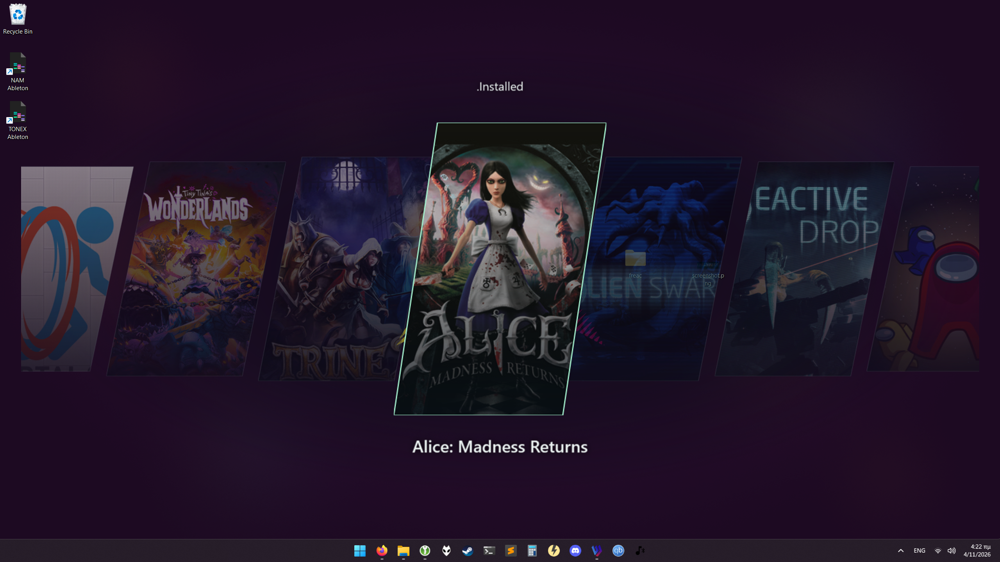

# Pad Launcher

A transparent Windows overlay for Steam with an angled artwork carousel. Shows your games, the current collection and optionally a game title. It reads your existing Steam library, non-Steam shortcuts, custom artwork and collections.

Integrations: **Steam**, **Epic Games Store**, **GOG Galaxy**, **EA App**, manual **Playnite** imports, and custom games. Optional **SteamGridDB** artwork uses your API key and is cached locally.

Demo: https://www.youtube.com/watch?v=5UMPjjPBHiU

## Usage

**[Download the latest PadLauncher.exe](https://github.com/lpv11/Pad-Launcher/releases/latest/download/PadLauncher.exe)** for Windows 10/11 (64-bit).

The first launch puts the app in your notification area, so it's best if you have it on auto-start on windows, then bind a controller button to launch the .exe; that opens the carousel.

Steam is detected automatically. If detection fails, set Steam installation folder(the folder containing `steam.exe` and `steamapps`) in settings. Set `UserId` to choose a specific local Steam profile, or leave it null for automatic selection.

## Tray and overlay

The first launch starts quietly in the tray and prepares the library without displaying the overlay. **Double-click the tray icon to toggle the overlay on/off.** The app keeps the overlay, library and decoded artwork in memory when dismissed with Circle/B or after launching a game. Running the executable again signals the existing process to show the overlay.

## Controls

The normal overlay displays no control prompts. Press **Options** (Xbox: Start) or **F1** to briefly show the controls in your chosen button style. No settings dialog opens.

| Action | Controller | Keyboard |
| --- | --- | --- |
| Browse games | Left stick / D-pad | Left / Right |
| Browse games at 3× speed | Right stick left / right | — |
| Launch selected game | Cross / A | Enter |
| Change collection | L1 / R1, LB / RB | Page Up / Page Down |
| Move to next monitor | Square / Xbox X / Nintendo Y | M |
| Exit app completely (overlay open) | Hold Circle / Xbox B / Nintendo A for 1 second | — |
| Brief control hint | Options / Start | F1 |
| Refresh games, artwork and collection membership | Hold Triangle / Y for 1 second | F5 |

## Manual Configuration

The app creates `settings.json` next to the executable. Exit the app completely before editing it. `settings.example.json` in this project shows the available fields.

## Inspiration

https://github.com/motor-dev/wallpaperCarousel
