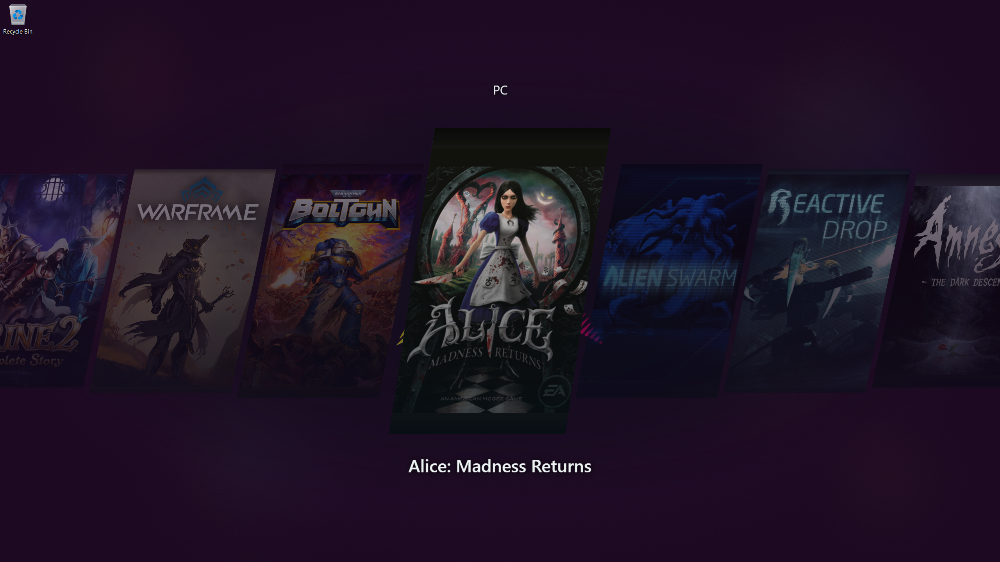

# Pad Launcher

A transparent, controller-friendly Windows game launcher with angled, rectangular and grid layouts. Browse games from multiple launchers, emulators and custom entries, with optional game titles and list names. Organise your games into individual or combined lists and use existing launcher artwork, local images or SteamGridDB covers.

Launchers supported: **Steam**, **GOG Galaxy**, **Epic Games Store**, **EA App**, **Ubisoft Connect**, **Battle.net**, **Rockstar Games Launcher**, **Xbox app** (installed Xbox / Game Pass titles), manual **Playnite** imports, and custom games. Optional **SteamGridDB** artwork uses your API key and is cached locally.

## Emulators

Supports **DuckStation, PCSX2, RPCS3, Xenia, Dolphin, Eden, melonDS, Vita3K, RetroArch, PPSSPP, mGBA, Cemu, Azahar and shadPS4**. Configure emulator paths, import libraries (including RetroArch playlists), scan ROM folders or add games manually. Core selection and launch arguments are configurable; imported games can be organised into lists.

There are 2 ways to import emulator games to the app:
- Import library from emulator: Reads the emulator’s configured game folders, playlists, registered games or installed titles, depending on the emulator. Folder-based libraries may involve scanning those folders.
- Scan ROM folders: Separately scans a folder you choose in Pad Launcher, including its subfolders. It does not require a library configured inside the emulator.
Both let you review detected games, rename new entries and choose a destination list before adding them. Repeating an import or scan reuses existing game entries without creating duplicates.

## Usage

**[Download the latest PadLauncher.exe](https://github.com/ctrlaltlp/Pad-Launcher/releases/latest/download/PadLauncher.exe)** for Windows 10/11 (64-bit).

Place `PadLauncher.exe` in its own writable folder before running it. The app creates `PadLauncher.Data` and `PadLauncher.Update` folders beside the executable for settings, artwork and temporary update files.

With a fresh data folder, an optional setup wizard helps configure launchers, emulators, artwork, controls and the overlay layout. Every page can be skipped; reopen it from **Settings → System → Restart setup**. Existing installations keep starting quietly in the notification area. Running the executable again opens the overlay.

Launchers are detected automatically. If detection fails, set the installation folder in **Settings → Launchers**. Use **Emulators → Settings → Detect installed emulators** to review emulator paths found through Windows registrations, Start-menu shortcuts and standard installation folders, or browse manually. Emulator games can then be imported from libraries, scanned from ROM folders or added manually.

## Controls

Choose PlayStation, Xbox or Nintendo button labels in **Settings → Controls**. Options / Start (or F1) briefly shows control hints and the game title.

| Action | Controller | Keyboard / mouse |
| --- | --- | --- |
| Browse games | D-pad / left stick; right stick for faster browsing | Left / Right |
| Move between grid rows | D-pad / left stick up and down | Up / Down |
| Launch selected game | Cross / Xbox A / Nintendo B | Enter, or click a game panel |
| Dismiss overlay | Tap Circle / Xbox B / Nintendo A | Esc |
| Exit app completely | Hold Circle / Xbox B / Nintendo A for 1 second | Tray → Exit app |
| Change list | L1 / R1, Xbox LB / RB, Nintendo L / R | Page Up / Page Down |
| Move to next monitor | Square / Xbox X / Nintendo Y | M |
| Refresh games, artwork and lists | Tap Triangle / Xbox Y / Nintendo X | F5 |
| Toggle favourite | R3 / right stick click | F |
| Jump to a chosen list (optional) | L3 / left stick click | — |
| Brief control hints and game title | Options / Start / Nintendo + | F1 |
| Open Settings | — | Tray menu → Settings |

Left and right stick speeds are adjustable in Controls (both default to 5×). D-pad and left stick up/down switch lists in Angled and Rectangular layouts. Grid keeps up/down row navigation. R3 always toggles favourites; show or hide the Favourites list under **Lists → Overlay lists**.

## Inspiration

https://github.com/motor-dev/wallpaperCarousel
